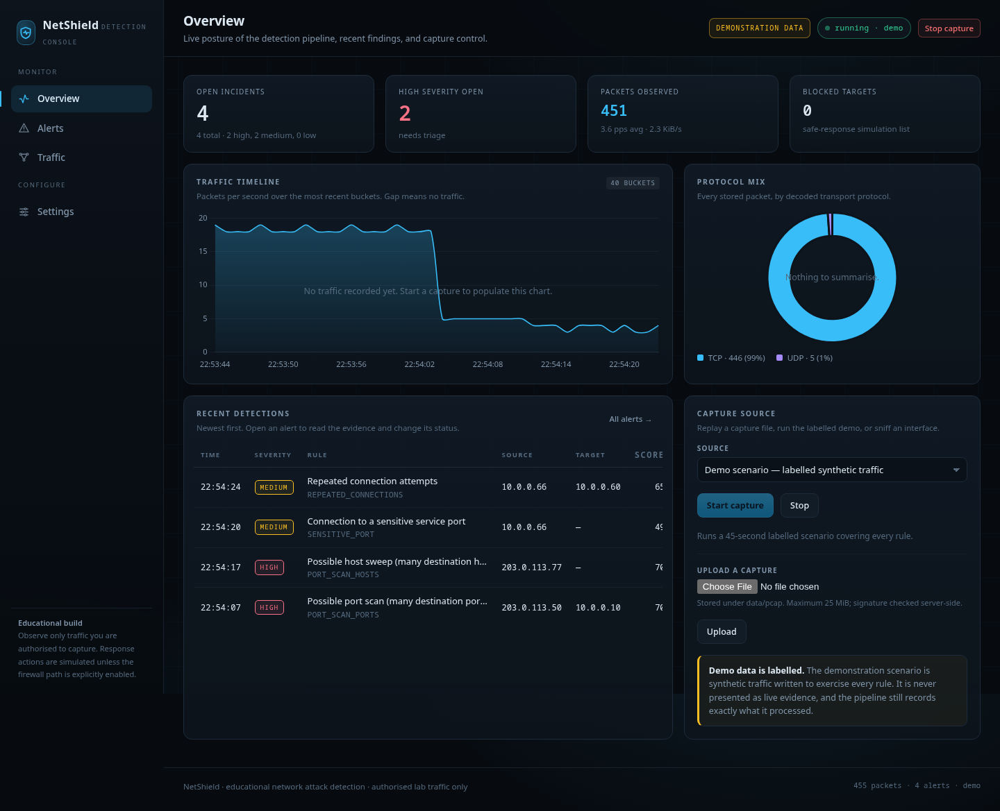
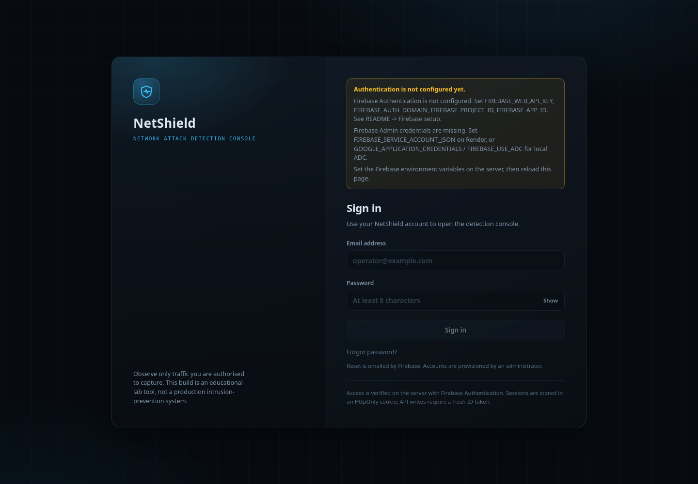
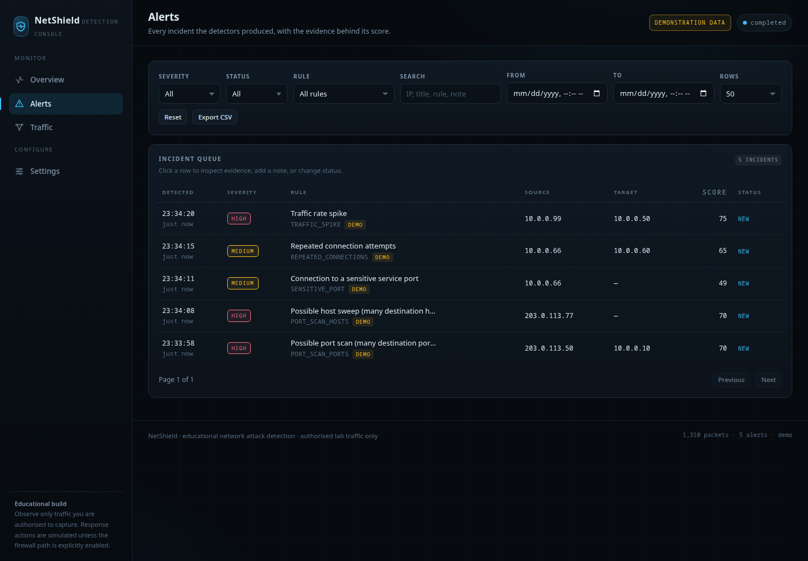
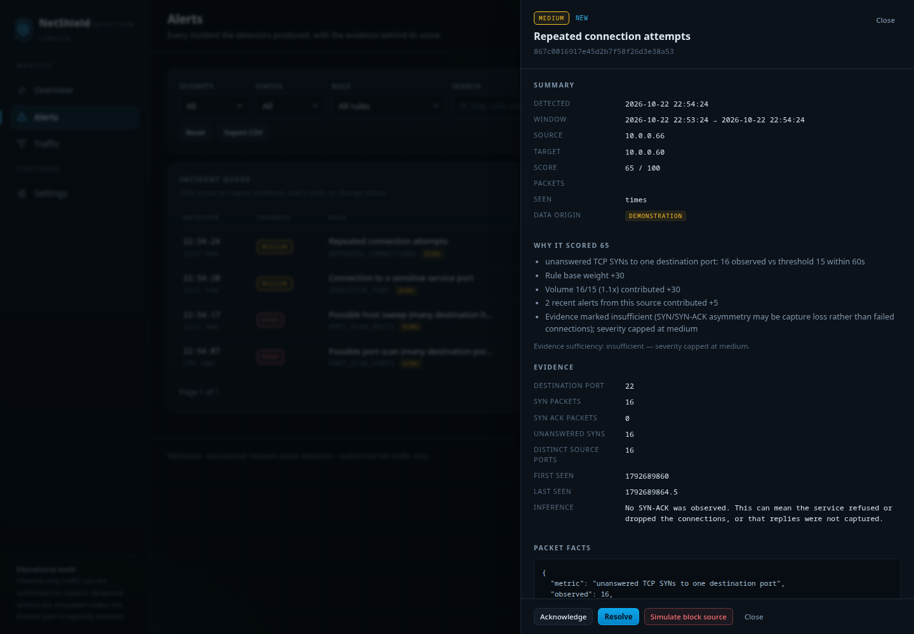
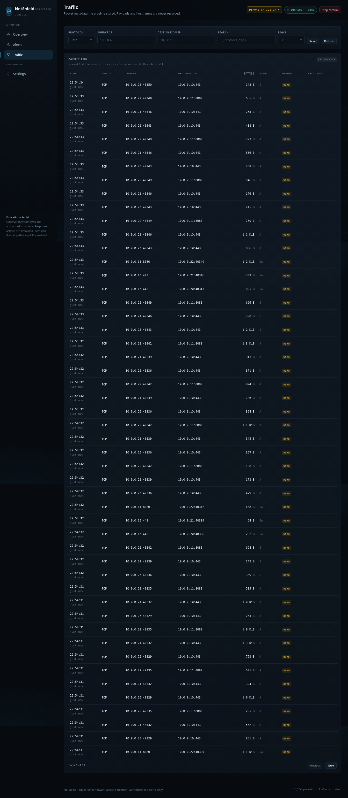
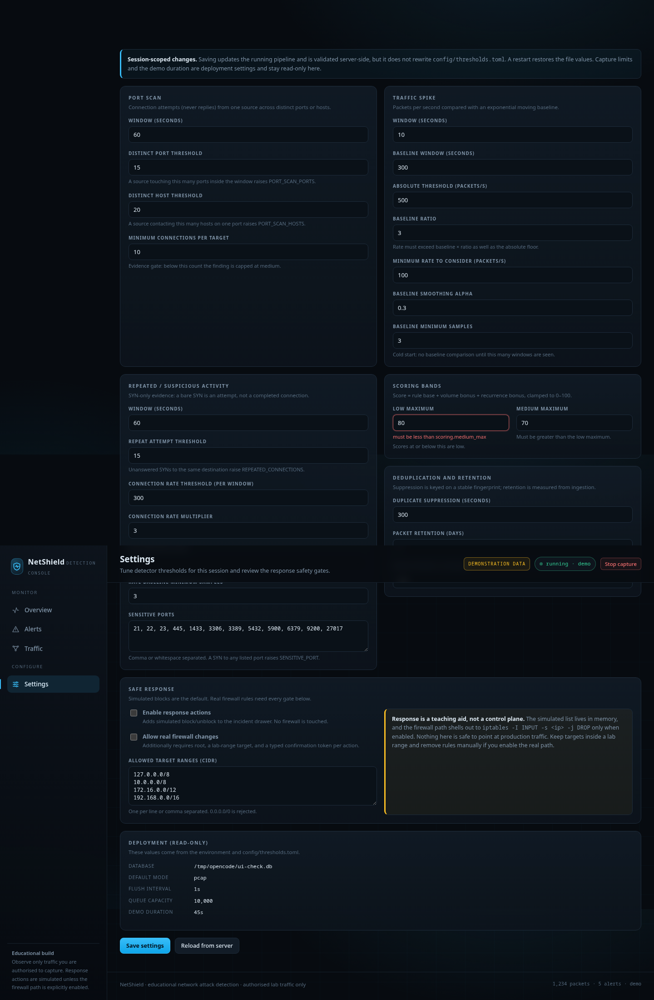
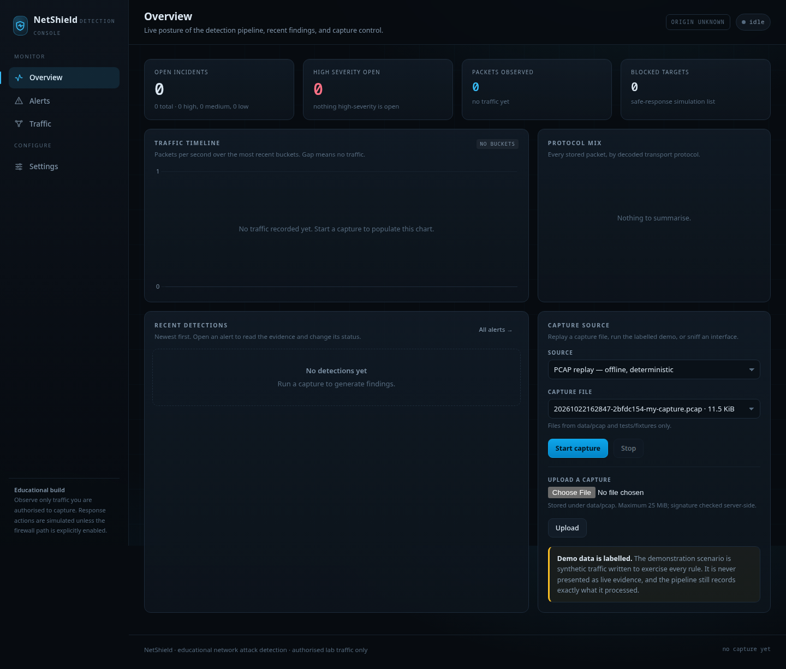

# NetShield

An educational network attack-detection system. It reads packet **metadata** from a
PCAP file, a labelled offline demo, or a live interface, applies seven transparent
heuristic rules, scores the observations, stores incidents in SQLite, and presents
them in a local web dashboard.

NetShield is a teaching tool, not a production IDS. It reports *observable evidence*
("one source contacted 40 ports in 60 seconds"), never "an attack happened", and it
never sends traffic.



## What it does

- Parses PCAP/PCAPNG captures with `scapy`; malformed and non-IP packets are counted
  and skipped, never fatal.
- Extracts per-source sliding-window features: distinct destination ports and hosts,
  unanswered SYNs, connection rate, per-second packet rate, EWMA baselines.
- Runs seven independent detectors and a visible scoring formula.
- Suppresses duplicates twice: an in-memory suppression window and a
  `UNIQUE(fingerprint)` database constraint.
- Persists incidents with evidence, facts, a plain-language score rationale, and an
  event timeline (created / acknowledged / resolved).
- Serves a JSON API and a four-page dashboard: Overview, Alerts, Traffic,
  Settings. All panels render from API responses; there is no hardcoded sample data.
- Requires Firebase Authentication (email/password) on every page and API except
  `/api/health`; real firewall actions additionally require an `admin` custom claim.
- Supports a **simulated** response action and an opt-in, lab-scoped `iptables` path.
- Labels synthetic runs as `demonstration` everywhere; the UI shows a badge.

## Honest limitations (read this first)

1. Heuristics do not prove intent. A port scan also matches an inventory scanner, an
   uptime monitor, or a vulnerability assessment.
2. "Unanswered SYN" cannot distinguish a closed service from asymmetric capture.
3. A packet-rate spike is not a DDoS. Backups, video calls, and file transfers look
   identical from rate alone.
4. IP blocking is weak containment: NAT/CGNAT, spoofing, and IPv6 privacy addresses
   all undermine attribution. The real-firewall path is a lab exercise, not a control.
5. A Wi-Fi NIC without switch mirroring sees only this host's traffic.
6. Windows live capture is not supported by the recommended setup; PCAP replay and the
   demo work everywhere.
7. Feature windows and the simulated block list live in memory and reset on restart.
8. Authentication proves *who* signed in, not *what they should do*: every active
   account can start/stop capture, change thresholds, and acknowledge alerts. Only
   real firewall actions are reserved for Firebase custom-claim admins. Create
   accounts deliberately in the Firebase Console; public self-registration is not
   offered.
9. Render's free plan has no persistent disk: SQLite incident history is lost on
   every deploy/restart unless you attach a disk (the supplied blueprint does).

## Quick start

Requirements: Python 3.11+ (tested on 3.14.7), Linux or macOS. `libpcap` is needed by
`scapy` for live capture; PCAP replay and the demo do not need it.

```bash
cd netshield
python3 -m venv .venv
. .venv/bin/activate
pip install -r requirements-dev.txt

python run.py
```

Open <http://127.0.0.1:5000/>. The app redirects to `/login` until Firebase is
configured and an account exists. Follow **Authentication (required)** below before
the first sign-in.

Command-line options:

```bash
python run.py --port 8080
python run.py --debug
python run.py --no-demo-pace     # run the demo scenario as fast as possible
```

Configuration is `config/thresholds.toml` plus `NETSHIELD_*` environment variables.
See `.env.example` for every variable. Changes made on the Settings page apply to the
current session; edit the TOML file to persist them.

## Authentication (required)

NetShield uses **Firebase Authentication with email/password**. The browser signs in
with the official Firebase JS SDK (vendored locally, not loaded from a CDN). Flask
verifies every credential server-side with the Firebase Admin SDK; there is no
client-side-only gate.

- Accounts are provisioned by an administrator in the Firebase Console. The login
  page supports sign-in and password reset, not open registration.
- Page navigations use a short-lived exchange: the browser posts its Firebase ID
  token to `/api/auth/session`, and Flask returns an HttpOnly, SameSite=Lax
  `netshield_session` cookie (5 days by default, `Secure` on HTTPS).
- API reads accept that cookie. **API writes (POST/PUT/DELETE) require
  `Authorization: Bearer <Firebase ID token>`**, so a stolen cookie cannot perform
  state changes (CSRF defence in depth).
- Missing, expired, revoked, or invalid credentials return `401`. ID tokens and
  session cookies are both checked against Firebase's revocation state, so a
  deleted/disabled account or an explicitly revoked session stops working without
  waiting for token expiry. This costs one Firebase Admin user lookup per
  authenticated request; it is appropriate for this single-instance console but
  would need caching at larger scale. A valid account without the required custom
  claim gets `403 forbidden`.
- `/api/health`, `/login`, and static assets are public. `/api/auth/session`
  accepts only a Bearer ID token, and `/api/auth/logout` only clears the cookie;
  every other page and API requires an authenticated credential.
- Real firewall actions (`/api/response`) require the `admin` custom claim.
  Simulated block/unblock is also gated behind admin in this build, while ordinary
  capture, settings, and alert triage remain available to any signed-in account.

### 1. Create the Firebase project

1. Create a project at <https://console.firebase.google.com/>.
2. **Authentication -> Sign-in method**: enable **Email/Password**.
3. **Authentication -> Users**: add the operator accounts. Use real addresses and
   strong passwords; there is no public sign-up.
4. **Project settings -> Your apps -> Web**: register a web app and copy the six
   config values (`apiKey`, `authDomain`, `projectId`, `storageBucket`,
   `messagingSenderId`, `appId`).
5. **Authentication -> Settings -> Authorized domains**: add `localhost` for local
   development and your Render hostname (for example
   `netshield.onrender.com`) or custom domain. Missing domains cause
   `auth/unauthorized-domain`.
6. **Project settings -> Service accounts -> Generate new private key**. Download
   the JSON once. This is a secret: never commit it, paste it into chat, or put it
   in a client-side file.

### 2. Configure the server

Copy `.env.example` to `.env` and fill in the six public web values. For admin
credentials choose **one**:

```dotenv
# Web config (public identifiers)
FIREBASE_WEB_API_KEY=...
FIREBASE_AUTH_DOMAIN=your-project.firebaseapp.com
FIREBASE_PROJECT_ID=your-project
FIREBASE_STORAGE_BUCKET=your-project.firebasestorage.app
FIREBASE_MESSAGING_SENDER_ID=...
FIREBASE_APP_ID=...

# Option A - local file path
GOOGLE_APPLICATION_CREDENTIALS=/absolute/path/to/service-account.json

# Option B - paste JSON as a single environment value (used on Render)
# FIREBASE_SERVICE_ACCOUNT_JSON={"type":"service_account",...}

# Option C - Application Default Credentials
# FIREBASE_USE_ADC=true
```

`FIREBASE_PROJECT_ID` must match the service account's `project_id`; a mismatch is
reported as a configuration error instead of failing open. Optional tuning:

| Variable | Default | Purpose |
|---|---|---|
| `NETSHIELD_SESSION_MAX_AGE` | `432000` (5 days) | Session cookie lifetime, 300..1209600 seconds |
| `NETSHIELD_COOKIE_SECURE` | `auto` | `auto` = Secure only on HTTPS; force with `true` in production |
| `NETSHIELD_TRUST_PROXY` | `false` | Trust one `X-Forwarded-*` hop (Render sets `true`) |
| `NETSHIELD_AUTH_RATE_LIMIT` | `30` | Session-mint attempts per IP per minute |

### 3. Grant an administrator

Find the user UID in **Authentication -> Users**, then set the custom claim with the
Admin SDK. Use the downloaded service-account file locally:

```bash
GOOGLE_APPLICATION_CREDENTIALS=/absolute/path/to/service-account.json python - <<'PYADMIN'
import firebase_admin
from firebase_admin import auth

firebase_admin.initialize_app()
auth.set_custom_user_claims("PASTE_USER_UID", {"admin": True})
print("admin claim set; sign out and back in to refresh the ID token")
PYADMIN
```

The claim is embedded in newly minted ID tokens. Sign the user out and back in (or
force-refresh the token) before testing `/api/response`. To revoke admin, clear the
claim **and revoke the user's refresh tokens**, otherwise an existing session cookie
keeps the old `admin` claim until it expires:

```python
import firebase_admin
from firebase_admin import auth

firebase_admin.initialize_app()
auth.set_custom_user_claims("PASTE_USER_UID", None)
auth.revoke_refresh_tokens("PASTE_USER_UID")
```

Revoking refresh tokens signs the user out everywhere; that is intentional when
removing an administrative role. Deleting or disabling a user is also enforced on
the next verification. Changing a password alone does **not** revoke existing
sessions, so use Firebase's **Revoke refresh tokens** action when offboarding.
Treat admin as the ability to alter host firewall rules, not as a cosmetic role.

### 4. Verify locally

```bash
. .venv/bin/activate
python run.py
```

Expected: `/api/health` returns `200` without auth; `/` redirects to
`/login?next=%2F`; the login page shows a configuration banner if any Firebase value
is missing; after sign-in the dashboard appears with a user chip and **Sign out**.

### Request behaviour

| Call | Credential | Result |
|---|---|---|
| `GET /api/health` | none | `200` |
| `GET /` without cookie | none | `302 /login?next=...` |
| `GET /api/overview` | no token | `401 unauthenticated` |
| `GET /api/overview` | Bearer ID token or session cookie | `200` |
| `POST /api/capture/start` | session cookie only | `403 csrf_required` |
| `POST /api/capture/start` | Bearer ID token | allowed |
| `POST /api/response` | non-admin Bearer token | `403 forbidden` |
| any protected route | Admin unavailable | `503 auth_unavailable` (fail closed) |

Session cookies are `HttpOnly`, `SameSite=Lax`, and `Secure` when HTTPS is detected
(or forced with `NETSHIELD_COOKIE_SECURE=true`). The dashboard CSP keeps
`script-src 'self'` and permits Firebase connections only to the Identity Toolkit,
Secure Token, Installations, and Google APIs endpoints; no wildcard origins.

## Three input modes

| Mode | What happens | Requirements |
|---|---|---|
| **PCAP replay** | Upload or pick a capture from `data/pcap` or `tests/fixtures`. Processed as fast as the pipeline allows. | none |
| **Demo** | 60 seconds of deterministic, labelled synthetic traffic: port scan, host sweep, repeated SYNs, UDP spike. | none |
| **Live capture** | `scapy` sniffs one explicitly selected interface. | root or `CAP_NET_RAW`; explicit authorization confirmation |

Live capture options, in order of preference:

```bash
# Preferred: grant only the capability, not full root.
sudo setcap cap_net_raw+eip "$(readlink -f .venv/bin/python)"
./.venv/bin/python run.py

# Fallback: run the whole app as root (not recommended).
sudo ./.venv/bin/python run.py
```

The dashboard probes capture capability and shows the actionable error if permission
is missing.

## The seven rules

| ID | Observation | Default threshold |
|---|---|---|
| `PORT_SCAN_PORTS` | Distinct destination ports from one source to one host (connection attempts only) | 15 ports / 60 s, at least 10 attempts |
| `PORT_SCAN_HOSTS` | Distinct destination hosts from one source | 20 hosts / 60 s |
| `REPEATED_CONNECTIONS` | Unanswered TCP SYNs to one destination service | 15 / 60 s |
| `SENSITIVE_PORT` | Connection attempts to an administrative/service port | 1 attempt alerts; 2+ is sufficient evidence |
| `CONN_RATE_ANOMALY` | TCP connections from one source | 300 / 60 s (sufficient only at 3x its own baseline) |
| `TRAFFIC_SPIKE` | Packets in a one-second bucket | 500 pps |
| `BASELINE_DEVIATION` | Rate vs. the capture's own EWMA baseline | 3x baseline, at least 100 pps, 3+ baseline samples |

Scoring:

```text
score = clamp(rule_base + volume_bonus + frequency_bonus, 0, 100)
severity: low < 34 <= medium < 67 <= high
evidence gate: insufficient evidence caps severity at medium
```

Every alert stores the reasons, the exact observed-vs-required values, a fingerprint,
`data_origin`, and a status. Full specifications and worked fixture numbers are in
[`docs/RULES.md`](docs/RULES.md).

## Screenshots

| Login | Alerts |
|---|---|
|  |  |

| Alert evidence | Traffic |
|---|---|
|  |  |

| Settings | Empty overview |
|---|---|
|  |  |

## Safe response

The default is `safe_response.enabled = false`. When enabled:

- `simulate_block` / `simulate_unblock` only mark an address as blocked in the
  dashboard (in-memory, max 500 entries, no host change).
- `firewall_block` / `firewall_unblock` additionally require
  `allow_firewall_changes = true`, root, a target inside the configured lab CIDRs,
  and the exact confirmation token (`BLOCK <ip>` / `UNBLOCK <ip>`). The action inserts
  or deletes one `iptables INPUT` rule and is logged in `response_actions`.

This is deliberately difficult to trigger. See
[`docs/THREAT_MODEL.md`](docs/THREAT_MODEL.md).

## Deploy to Render

`render.yaml` is a working Blueprint for one web service plus a 1 GB persistent
disk. The database path is `/var/data/netshield.db`; the disk keeps SQLite history
across deploys. **Do not raise the worker count**: capture state and feature windows
live in process memory, so Gunicorn must run `--workers 1`. Threads provide request
concurrency.

### Blueprint deploy

1. Push the repository to GitHub (the `main` branch).
2. Render Dashboard -> **New -> Blueprint** -> select the repository. Render reads
   `render.yaml`.
3. Fill the six `FIREBASE_*` web values and `FIREBASE_SERVICE_ACCOUNT_JSON` (paste the
   entire service-account JSON; Render stores it as a secret). Keep
   `NETSHIELD_COOKIE_SECURE=true` and `NETSHIELD_TRUST_PROXY=true`.
4. Deploy. The health check is `GET /api/health`; the start command is:
   `gunicorn --workers 1 --threads 4 --timeout 120 --access-logfile - --bind 0.0.0.0:$PORT wsgi:app`.
5. Add the Render hostname to Firebase **Authentication -> Settings -> Authorized
   domains**, then create users and grant the admin claim as above.
6. Open the URL, sign in, and verify `/api/health` plus one page reload.

The blueprint requests the `starter` plan because persistent disks are not available
on free instances. On a free plan, remove the `disk:` block and expect SQLite data to
reset on every deploy; set `NETSHIELD_DB_PATH` to a writable path such as
`/tmp/netshield.db` only for evaluation.

`NETSHIELD_TRUST_PROXY=true` enables `ProxyFix` for exactly one proxy hop. Without
it, Flask sees the internal HTTP hop and may not mark the session cookie `Secure`.
Do not enable it when connecting directly, and do not expose Gunicorn without TLS.

### Render environment checklist

```text
FIREBASE_WEB_API_KEY, FIREBASE_AUTH_DOMAIN, FIREBASE_PROJECT_ID,
FIREBASE_STORAGE_BUCKET, FIREBASE_MESSAGING_SENDER_ID, FIREBASE_APP_ID
FIREBASE_SERVICE_ACCOUNT_JSON   (secret; one JSON value)
NETSHIELD_DB_PATH=/var/data/netshield.db
NETSHIELD_TRUST_PROXY=true
NETSHIELD_COOKIE_SECURE=true
NETSHIELD_SECRET_KEY            (generated by the blueprint)
NETSHIELD_AUTH_RATE_LIMIT=30
```

Never commit `.env`, `service-account*.json`, or the pasted JSON. The supplied
`.gitignore` excludes these patterns.

### Authentication troubleshooting

| Symptom | Cause and fix |
|---|---|
| Login page says authentication is not configured | One or more `FIREBASE_*` web variables are missing. The banner names the missing keys. |
| `auth/unauthorized-domain` | Add the exact hostname (no scheme) under Firebase Authorized domains. |
| `auth/operation-not-allowed` | Email/Password provider is disabled in Firebase Authentication. |
| `503 auth_unavailable` in the UI/API | Admin credentials missing, malformed, or project mismatch. Check Render logs; the app never accepts requests unauthenticated. |
| Sign-in succeeds, then redirects back to login | Cookie blocked or `Secure`/HTTPS mismatch. On Render set both proxy and cookie variables; check browser cookie settings and clock skew. |
| `401` on writes from the dashboard | ID token expired and refresh failed. Reload; the client refreshes once, then redirects to login. |
| `403 forbidden` on response actions | Set `{"admin": true}` custom claim and sign in again. |
| `AuthUnavailable` certificate message | Render cannot reach Google public-key endpoints; check outbound networking/DNS. |

## Privacy

Only packet metadata is stored: timestamp, addresses, ports, protocol, TCP flags,
size, and source/origin. Payloads, DNS names, and MAC addresses are never stored.
CSV export prefixes spreadsheet formula characters to prevent formula injection.
Authentication sends email addresses and tokens to Firebase/Google; NetShield does
not store passwords, ID tokens, or session cookies in SQLite. The browser keeps its
Firebase session in browser storage, and the server cookie is HttpOnly.

## Project layout

```text
netshield/                 Python package
  config/                  settings dataclasses + TOML loader
  capture/                 pcap, live, and synthetic sources
  features/                flow extraction and sliding-window aggregation
  detectors/               five detector modules + dedup
  scoring/                 additive scorer and severity bands
  storage/                 SQLite schema, connection management, repositories
  api/                     Flask app factory, JSON routes, validation, errors
  auth/                    Firebase config, token/session verification, guard
  dashboard/               Jinja shell/login, CSS, JS, vendored Chart.js + Firebase
  pipeline.py              producer/worker pipeline
  responses.py             gated simulated/firewall response service
config/thresholds.toml     all detection thresholds
run.py                     local development entry point
wsgi.py                    Gunicorn entry point (one worker)
render.yaml                Render Blueprint (disk, env, health check)
tests/                     268 tests (unit + integration) and PCAP fixtures
tools/generate_fixtures.py deterministic offline fixture generator
docs/                      architecture, rules, runbook, demo script, threat model
```

## Tests

```bash
. .venv/bin/activate
python -m pytest
```

Expected: `268 passed`. The suite covers PCAP tolerance, feature counters, each rule
below/at/above threshold, false-positive regressions, scoring and the evidence gate,
deduplication, SQLite persistence and retention, the full API contract, response
gating, dashboard rendering/security headers, and authentication: public routes,
redirects, missing/expired/revoked tokens, session cookies, CSRF-style write
blocking, admin claims, fail-closed outages, and rate limiting. Firebase is stubbed;
no test needs a Firebase project, opens a live capture, or sends network traffic.

## Documentation

- [`docs/ARCHITECTURE.md`](docs/ARCHITECTURE.md) — as-built design, data flow, contracts
- [`docs/RULES.md`](docs/RULES.md) — rule specs, scoring, fixture-verified examples
- [`docs/RUNBOOK.md`](docs/RUNBOOK.md) — install, operate, troubleshoot, reset
- [`docs/DEMO_SCRIPT.md`](docs/DEMO_SCRIPT.md) — 10-minute classroom walkthrough
- [`docs/THREAT_MODEL.md`](docs/THREAT_MODEL.md) — assets, abuse cases, controls
- [`docs/VIVA_QUESTIONS.md`](docs/VIVA_QUESTIONS.md) — likely questions with answers
- `README.md` -> **Authentication (required)** and **Deploy to Render** — setup, claims, env, troubleshooting

## Academic context

Built for the *Cyber Security & Laws* open elective as a network attack detection
mini-project. The design emphasises modularity, testability, explainability, and
authorization boundaries over detection coverage. It does not generate attack
traffic and must only be pointed at traffic the operator is authorized to observe.

The code is provided for coursework and review. No license is granted beyond what
your institution's policy allows; add one before redistributing.
